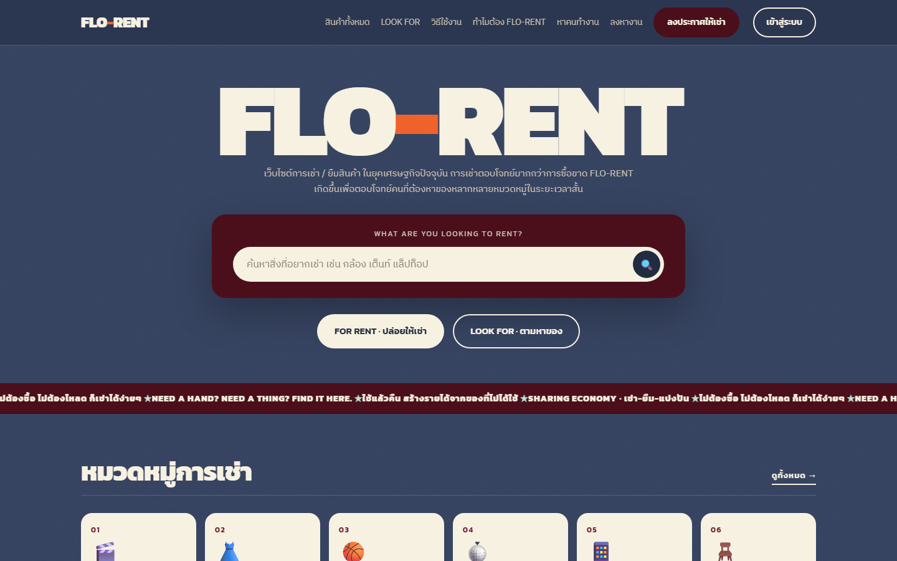
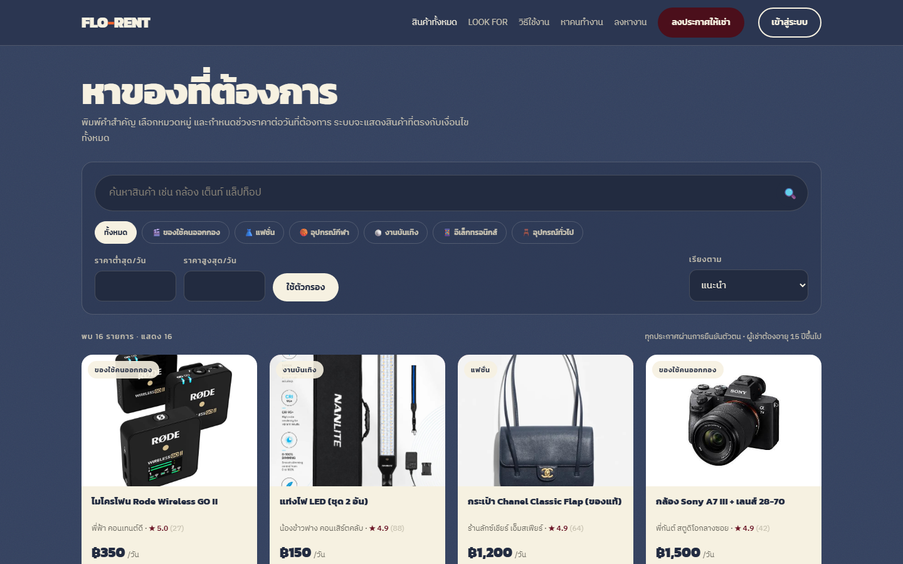
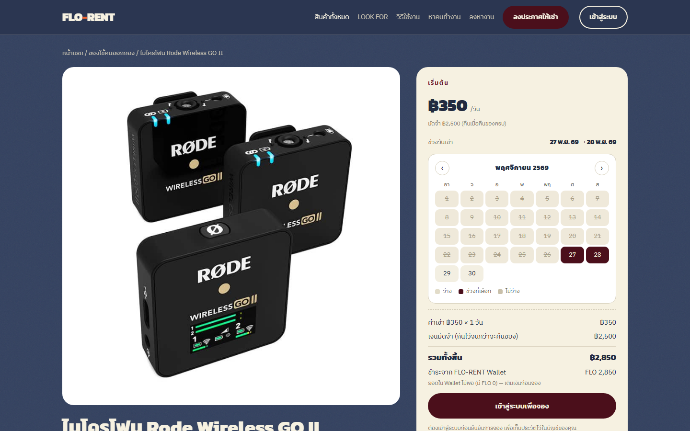
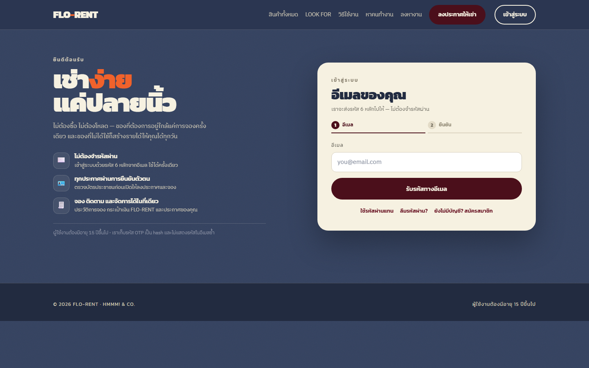
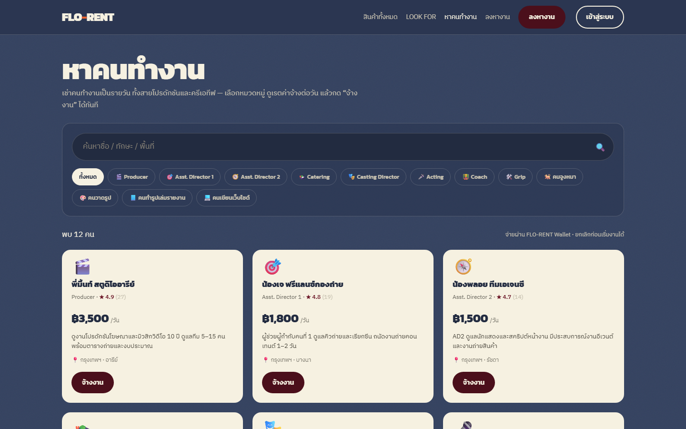
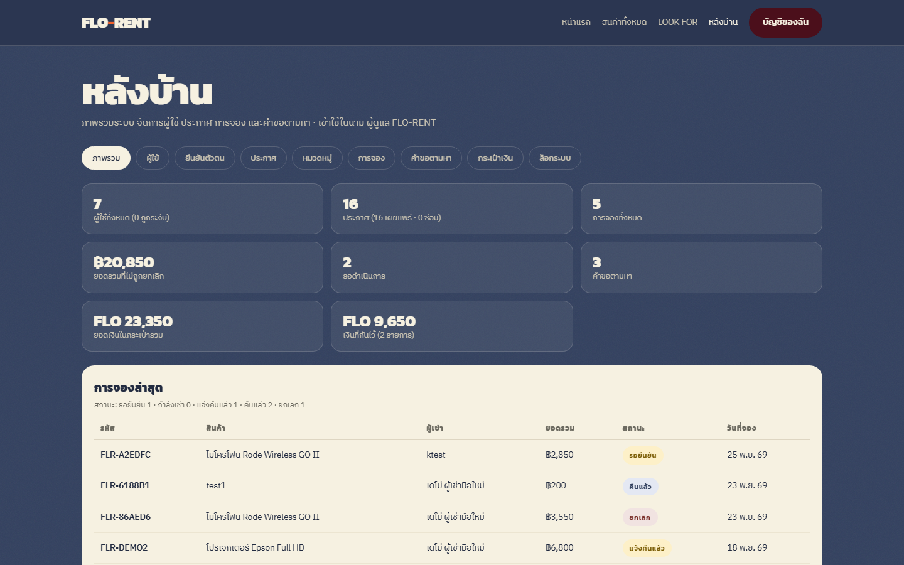
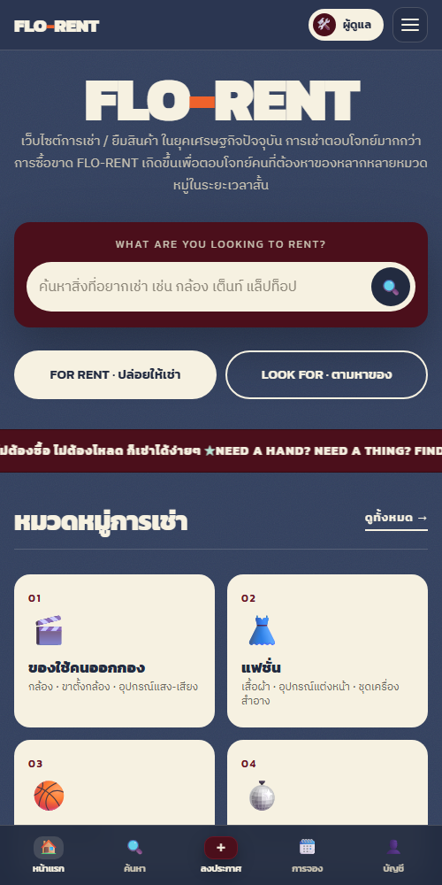

<div align="center">

# FLO-RENT

**ตลาดกลางให้เช่า–ยืมสินค้า สำหรับคนที่อยากได้ของใช้ชั่วคราวโดยไม่ต้องซื้อ**

หน้าเว็บ static + เซิร์ฟเวอร์ Node.js ที่ไม่ต้องติดตั้ง dependency ภายนอก — เข้าสู่ระบบด้วย OTP ทางอีเมล, ยืนยันตัวตนด้วยบัตรประชาชน, จอง–คืนของ, กระเป๋าเงิน และหน้าแอดมิน อยู่ในระบบเดียว


[เว็บไซต์จริง](https://flo-rentp-dew-flo-rent-web-1.vercel.app) · [คู่มือ tech stack (PDF)](flo-rent-main/flo-rent-web/docs/FLO-RENT-techstack.pdf) · [เอกสารละเอียดทั้งหมด](flo-rent-main/flo-rent-web/README.md)

</div>

---

## ภาพรวมโปรเจกต์

FLO-RENT เป็นตลาดกลางสำหรับปล่อยของที่ไม่ได้ใช้ให้คนอื่นเช่า ตั้งแต่กล้อง แล็ปท็อป ไปจนถึงอุปกรณ์แคมป์ปิ้ง ผู้ใช้ลงประกาศ ตั้งราคาต่อวัน รับคำขอจอง และติดตามสถานะการคืนของได้ในที่เดียว

โจทย์ที่อยากแก้มีสี่ข้อ: คนไม่อยากจำรหัสผ่าน, กลัวโดนโกงหรือของหาย, ไม่รู้ว่าจะเชื่อใครได้ และการจองที่หลุดการติดตามง่ายเกินไป สิ่งที่ออกมาจึงเป็น OTP ทางอีเมลแทนรหัสผ่าน, การยืนยันตัวตนก่อนทำธุรกรรม, เงินมัดจำต่อรายการ และสถานะการจองที่เดินครบวงจรตั้งแต่ขอยืนยันไปจนถึงคืนของ

## ภาพหน้าจอ

| หน้าแรก | ค้นหาสินค้า |
| --- | --- |
|  |  |

| รายละเอียดสินค้า + ปฏิทินวันว่าง | เข้าสู่ระบบด้วย OTP |
| --- | --- |
|  |  |

| หาคนทำงาน | หลังบ้านแอดมิน |
| --- | --- |
|  |  |

<p align="center">
  
</p>

ภาพทั้งหมดถ่ายจากข้อมูลตัวอย่างในโหมดเดโม (`npm start`) ไม่มีข้อมูลผู้ใช้จริง

## ฟีเจอร์หลัก

**ผู้เช่า**
- ค้นหาและกรองสินค้าตามหมวดหมู่ ช่วงราคา และช่วงวันที่ว่าง
- หน้าสินค้าคำนวณค่าเช่า + มัดจำตามจำนวนวันให้ทันที พร้อมปฏิทินวันว่าง
- จองและติดตามสถานะได้จากหน้าประวัติการจอง ยกเลิกได้ก่อนผู้ให้เช่ายืนยัน
- กระเป๋าเงิน FLO-RENT สำหรับมัดจำและค่าเช่า

**ผู้ให้เช่า**
- ลงประกาศพร้อมรูปหลายรูป หมวดหมู่ ราคาต่อวัน และมัดจำ
- กล่อง "คำขอจองที่เข้ามา" — ยืนยัน ปฏิเสธ หรือกดรับคืนของได้จากหน้าโปรไฟล์
- ประกาศความต้องการเช่า (LOOK FOR) และรับข้อเสนอจากผู้ให้เช่าหลายราย
- ประกาศงาน/รับงาน (WORK) สำหรับงานที่ต้องใช้คน

**ผู้ดูแลระบบ**
- แดชบอร์ดสถิติ, จัดการผู้ใช้/ประกาศ/การจอง/คำขอ
- อนุมัติหรือปฏิเสธการยืนยันตัวตน พร้อมดูรูปบัตร (ทุกการเปิดดูถูกบันทึกในล็อก)
- จัดการหมวดหมู่ กระเป๋าเงิน และดูบันทึกเหตุการณ์ของระบบ

**ความปลอดภัย**
- OTP เก็บเป็น HMAC-SHA256 ไม่เก็บรหัสจริง ใช้ครั้งเดียว อายุ 10 นาที ผิดได้ 5 ครั้ง
- รหัสผ่าน hash ด้วย `scrypt` + salt ต่อผู้ใช้
- เลขบัตรประชาชน เก็บเป็น SHA-256 + salt และเก็บเฉพาะ 4 ตัวท้ายไว้แสดง
- รูปบัตรเข้ารหัส AES-256-GCM หมดอายุ 30 วัน และทุกการเปิดดูถูกบันทึก
- ลืมรหัสผ่านต้องยืนยัน OTP ก่อนเสมอ และตัด session เดิมทั้งหมดเมื่อเปลี่ยนรหัส
- ตรวจ token และ Origin ทุก endpoint ที่เขียนข้อมูล พร้อม rate limit ต่อ IP

## Tech stack

| ชั้น | เทคโนโลยี | เหตุผล |
| --- | --- | --- |
| Frontend | HTML5, CSS3, JavaScript vanilla | ไม่มี build step — เปิดอ่านโค้ดได้ตรง ๆ และ deploy ได้ทันที |
| Backend | Node.js `http` module ล้วน (ไม่ใช้ Express) | ควบคุมทุก byte ของ response, cold start เร็ว, ไม่มี dependency ให้ตามแพตช์ |
| Data (local) | JSON file + atomic write | รันในเครื่องได้โดยไม่ต้องติดตั้งฐานข้อมูล |
| Data (production) | Upstash Redis ผ่าน REST + Lua CAS | หลาย instance เขียนพร้อมกันได้โดยข้อมูลไม่สูญหาย |
| Auth | OTP ทางอีเมล (HMAC-SHA256), `scrypt`, bearer token | ไม่เก็บรหัส OTP จริง และไม่เก็บรหัสผ่านแบบย้อนกลับได้ |
| Email | Brevo / Resend ผ่าน HTTPS `fetch` | ไม่ต้องใช้ SDK และสลับผู้ให้บริการได้ด้วย env ตัวเดียว |
| Hosting | Vercel — static `public/` + serverless `api/index.js` | ฟรี ผูกกับ Git, preview ต่อ PR |
| Testing | `node:test` + `node:assert` | มาพร้อม Node ไม่ต้องเพิ่ม dev dependency |

## เริ่มต้นใช้งาน

ต้องมี **Node.js 18 ขึ้นไป** (ทดสอบบน v22) — ไม่ต้อง `npm install`

```bash
git clone https://github.com/Mean442/Flo-rent_p-dew.git
cd Flo-rent_p-dew/flo-rent-main/flo-rent-web
npm start
```

เปิด **http://127.0.0.1:4173**

> เปิด `index.html` ด้วยการดับเบิลคลิกไม่ได้ เพราะหน้าเว็บต้องเรียก API — ถ้าเปิดแบบ `file://` จะมีข้อความบอกวิธีรันเซิร์ฟเวอร์ขึ้นมาแทน

> แก้ไฟล์ใน `server/` ต้องรีสตาร์ท `npm start` ใหม่ ส่วนไฟล์ใน `public/` ไม่ต้องรีสตาร์ท — เซิร์ฟเวอร์อ่านจากดิสก์ทุกครั้งและส่ง `Cache-Control: no-cache` มาให้อยู่แล้ว

เปลี่ยนพอร์ต/โฮสต์:

```bash
PORT=8080 HOST=127.0.0.1 npm start
```

บน Windows ถ้า PowerShell บล็อก `npm` ให้ดับเบิลคลิก `start.cmd` (สคริปต์เดียวกันที่เรียก `node server\server.js` ตรง ๆ)

## ตัวแปรสภาพแวดล้อม

คัดลอก [`.env.example`](flo-rent-main/flo-rent-web/.env.example) เป็น `.env` ที่รากโปรเจกต์ แล้วเติมค่า — `server/env.js` โหลดให้เอง (`.env*` ถูก gitignore ไว้แล้ว) ไฟล์ตัวอย่างไม่มี secret ใด ๆ

| ตัวแปร | ความหมาย |
| --- | --- |
| `NODE_ENV` | `production` = ไม่สร้างบัญชีทดลอง/ข้อมูลตัวอย่าง และบล็อกอีเมลทดลอง |
| `PORT` / `HOST` | พอร์ตและโฮสต์ในเครื่อง (ค่าเริ่มต้น `4173` / `127.0.0.1`) |
| `FLO_ADMIN_EMAIL` / `FLO_ADMIN_PASSWORD` | บัญชีแอดมิน (รหัสผ่านอย่างน้อย 10 ตัวอักษร) |
| `BREVO_API_KEY` / `RESEND_API_KEY` | คีย์ผู้ให้บริการอีเมล OTP (เลือกอย่างน้อยหนึ่งตัว) |
| `FLO_MAIL_FROM` | ผู้ส่ง เช่น `FLO-RENT <no-reply@yourdomain.com>` |
| `FLO_DATA_DIR` | โฟลเดอร์เก็บ `db.json` |
| `FLO_SEED_CATALOG` | แคตตาล็อกตั้งต้น 16 รายการ (บน Vercel เปิดอัตโนมัติ, `=0` เพื่อปิด) |
| `KV_REST_API_URL` / `KV_REST_API_TOKEN` | Upstash/KV REST — เปิดโหมดเก็บข้อมูลบน Redis |
| `FLO_ID_SALT` / `FLO_ID_ENCRYPTION_KEY` / `FLO_OTP_SECRET` | salt, คีย์เข้ารหัส, secret สำหรับ HMAC |

ตารางครบทุกตัวแปรอยู่ใน [`.env.example`](flo-rent-main/flo-rent-web/.env.example)

## การทดสอบ

```bash
npm test
```

รันด้วย `node:test` ทั้งหมด **71 เคส** ใน 5 ไฟล์ — ตั้ง `NODE_ENV=test` จึงไม่ส่งอีเมลจริงออกไป และใช้โฟลเดอร์ข้อมูลชั่วคราวจึงไม่แตะ `server/data/db.json`

| ไฟล์ | ครอบคลุม |
| --- | --- |
| `test/api.test.js` | เส้นทาง API หลัก: สมัคร, OTP, จอง, กระเป๋าเงิน, สิทธิ์แอดมิน |
| `test/system.test.js` | สถานะการจองทั้งวงจร, การกันจองซ้อน, การคืนมัดจำ |
| `test/verify.test.js` | checksum เลขบัตร, การเข้ารหัสรูป, การหมดอายุ |
| `test/ui.test.js` | มาร์กอัป/สไตล์ของ shell มือถือ, skeleton, sticky CTA |
| `test/login.test.js` | split panel, stepper 3 ขั้น, OTP 6 ช่อง, ทางลืมรหัสผ่าน |

## ข้อมูลตัวอย่าง/บัญชีทดลอง

โหมดเดโมจะสร้างข้อมูลตัวอย่าง 16 รายการ, คนทำงาน 12 คน, ประกาศงาน 3 รายการ และบัญชีทดลองให้อัตโนมัติเมื่อ **ไม่** รันด้วย `NODE_ENV=production`

| บทบาท | อีเมล | รหัสผ่าน |
| --- | --- | --- |
| ผู้ใช้ | `demo@flo-rent.co` | `demo1234` |
| ผู้ให้เช่า | `owner@flo-rent.co` | `owner1234` |
| ผู้ดูแลระบบ | `admin@flo-rent.co` | `admin1234` |

บัญชีผู้ใช้/ผู้ให้เช่าเป็นบัญชีทั่วไป — ล็อกอินด้วยรหัสผ่านแล้วต้องยืนยัน OTP ต่อ (โหมดเดโมที่ยังไม่ตั้งค่าอีเมลจะแสดงรหัสบนหน้าเว็บให้กรอก) ส่วนแอดมินเข้าได้ด้วยรหัสผ่านทันที

## สิ่งที่ต้องตั้งค่าก่อน deploy

1. **ที่เก็บข้อมูล** — Vercel เขียนดิสก์ถาวรไม่ได้ ต้องเชื่อม **Upstash for Redis** และตั้ง `KV_REST_API_URL` / `KV_REST_API_TOKEN` (ตั้งให้อัตโนมัติเมื่อเชื่อม Storage)
2. **อีเมล OTP** — ต้องมี `BREVO_API_KEY` และ `FLO_MAIL_FROM` ที่ยืนยันแล้ว ถ้าไม่ตั้ง คำขอ OTP ทุกทางจะตอบ **503** (แอดมินยังล็อกอินด้วยรหัสผ่านได้)
3. **แอดมิน** — `FLO_ADMIN_EMAIL` / `FLO_ADMIN_PASSWORD` **ห้ามใช้ `admin@flo-rent.co`** บน production เพราะระบบบล็อกอีเมลทดลองก่อนตรวจรหัสผ่าน
4. **คีย์ความปลอดภัย** — `FLO_ID_SALT`, `FLO_ID_ENCRYPTION_KEY`, `FLO_OTP_SECRET` ตั้งเป็นค่าสุ่ม
5. **Root Directory บน Vercel** = `flo-rent-main/flo-rent-web`
6. ตรวจหลังขึ้น production: `GET /api/health` ต้องได้ `{"demo":false,"mail":"brevo"}`

## โครงสร้างโปรเจกต์

```text
Flo-rent_p-dew/
├── README.md                      ← ไฟล์นี้ (หน้าแรกของ repo)
├── .gitignore
└── flo-rent-main/flo-rent-web/    ← ตัวแอปพลิเคชัน
    ├── api/index.js               # entrypoint ของ Vercel
    ├── server/                    # server.js, auth.js, db.js, mailer.js, env.js, verify.js
    ├── public/                    # 12 หน้า HTML + css/ + js/
    ├── test/                      # 5 ไฟล์ทดสอบ
    ├── docs/                      # คู่มือ PDF + screenshots/
    ├── vercel.json
    └── package.json
```

## สิทธิ์การใช้งาน

โปรเจกต์นี้ยังไม่ได้ระบุสัญญาอนุญาต (license) จึงยังไม่มีการให้สิทธิ์นำโค้ดไปใช้ต่อแบบสาธารณะ — หากต้องการนำไปใช้หรือดัดแปลง กรุณาติดต่อเจ้าของโปรเจกต์ก่อน

## เอกสารละเอียดเพิ่มเติม

- **[คู่มือ tech stack ฉบับเต็ม (PDF, 20 หน้า)](flo-rent-main/flo-rent-web/docs/FLO-RENT-techstack.pdf)** — อธิบายทุกชั้นของระบบตั้งแต่ HTTP request แรกจนถึง Redis CAS พร้อมตัวอย่างโค้ดจริง
- **[README ฉบับนักพัฒนา](flo-rent-main/flo-rent-web/README.md)** — เส้นทางระบบ, ตาราง API, ความปลอดภัย, บันทึกผู้พัฒนา และขั้นตอน deploy ละเอียด

---

<div align="center">

**FLO-RENT — HMMM! & CO.**

สร้างด้วย Node.js ล้วน ๆ และความตั้งใจที่จะไม่เพิ่ม dependency ที่ไม่จำเป็น

</div>
